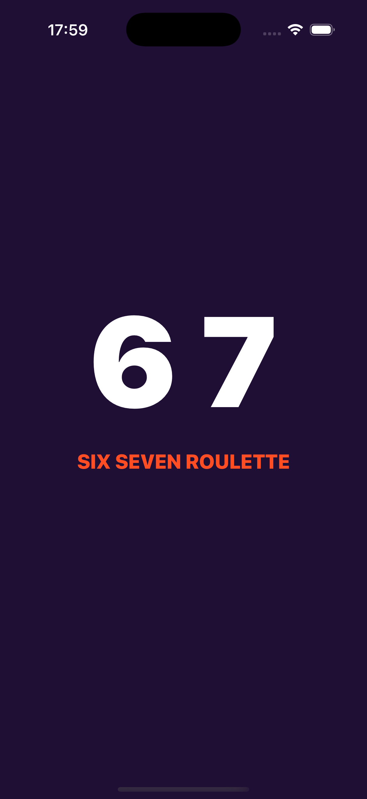
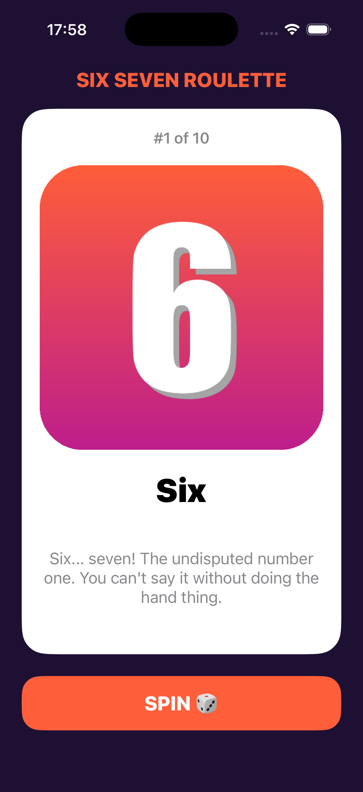
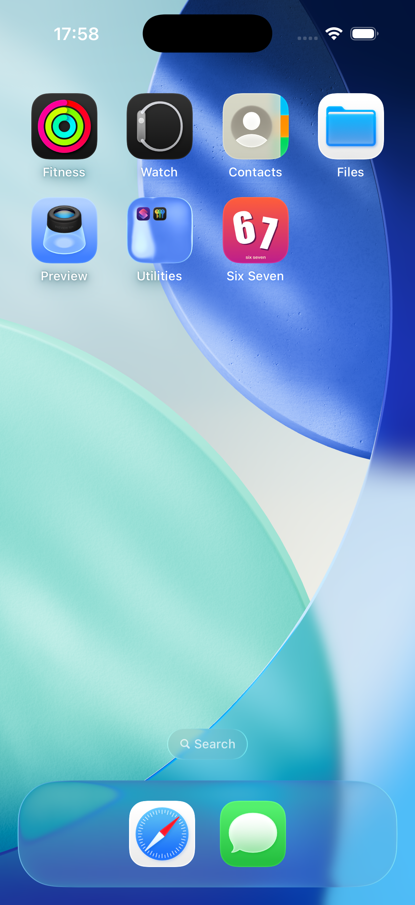

# Six Seven — Favorites Roulette (Lab 6)

Single-screen UIKit app that shows a random card from my 10 favorite digits.
My ranking: **6 7 0 1 2 4 5 8 9 3**.

- Storyboard + Swift, no Auto Layout constraints (frames + autoresizing masks)
- Favorites stored as `[Favorite]` (struct) in `Favorite.swift`
- Tap **SPIN** to get a random digit; the same one never shows twice in a row
- Custom launch screen and "6 7" app icon

| Launch screen | Main screen | Home Screen |
| --- | --- | --- |
|  |  |  |
